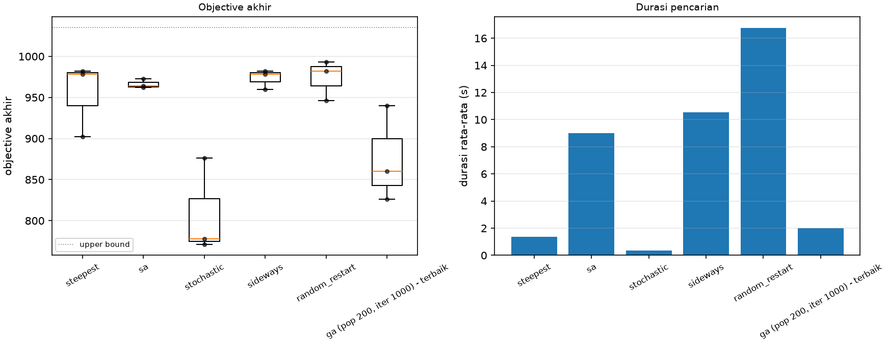
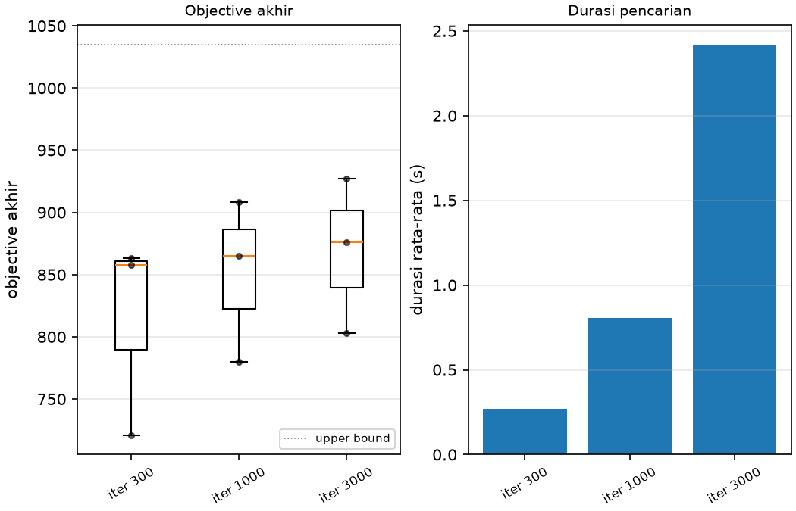
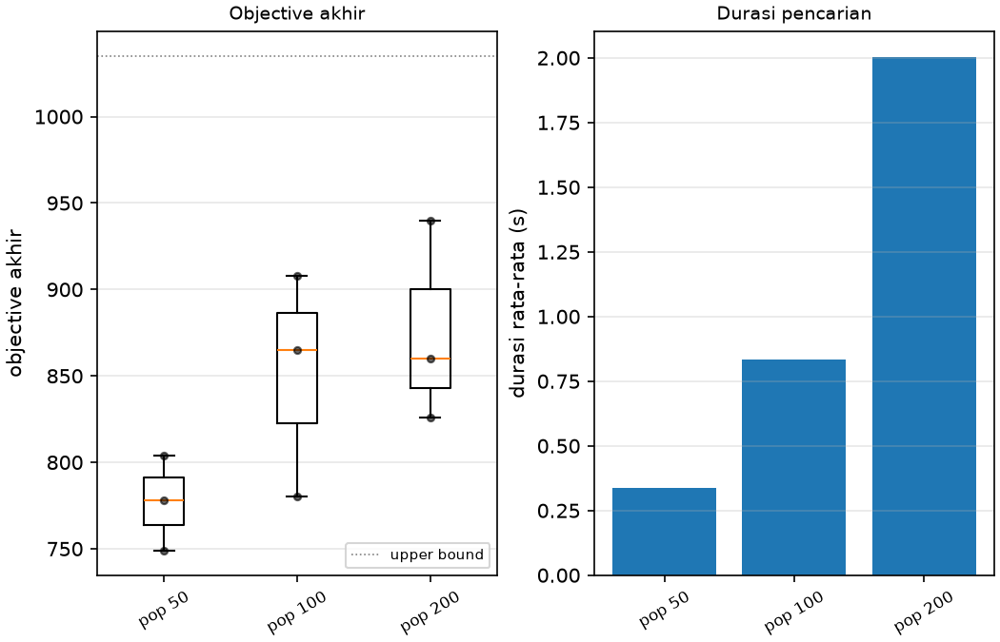

# Ringkasan eksperimen

Dibuat oleh `src/experiments.py` pada 2026-10-22 12:43.
Mesin pembuat ringkasan: Linux-7.2.9-arch1-1-x86_64-with-glibc2.44 | CPU x86_64 (22 thread) | Python 3.14.7.
Run tersedia: 39. Durasi = search saja (`duration_s`), tidak termasuk menyimpan file dan gambar.

Mesin search tersimpan:
- Linux-7.2.9-arch1-1-x86_64-with-glibc2.44 | CPU x86_64 (22 thread) | Python 3.14.7

### 4.1 Hill-Climbing - Steepest Ascent

| Run | Seed | Obj awal | Obj akhir | Fee | Feasible | Gap UB | Iterasi | Evals | Durasi (s) |
|---|---|---|---|---|---|---|---|---|---|
| 1 | 1 | -21226 | 982 | 982 | True | 5.1% | 16 | 208453 | 1.251 |
| 2 | 2 | -50553 | 978 | 978 | True | 5.5% | 20 | 258032 | 1.549 |
| 3 | 3 | -28402 | 902 | 902 | True | 12.9% | 17 | 221239 | 1.327 |
| **mean ± std** |  |  | 954.0 ± 45.1 | 954.0 ± 45.1 |  |  |  |  | 1.376 ± 0.155 |

### 4.2 Hill-Climbing - Stochastic (Bonus 2)

| Run | Seed | Obj awal | Obj akhir | Fee | Feasible | Gap UB | Iterasi | Evals | Durasi (s) |
|---|---|---|---|---|---|---|---|---|---|
| 1 | 1 | -21226 | 778 | 778 | True | 24.8% | 36486 | 36487 | 0.405 |
| 2 | 2 | -50553 | 876 | 876 | True | 15.4% | 32510 | 32511 | 0.365 |
| 3 | 3 | -28402 | 771 | 771 | True | 25.5% | 24504 | 24505 | 0.277 |
| **mean ± std** |  |  | 808.3 ± 58.7 | 808.3 ± 58.7 |  |  |  |  | 0.349 ± 0.065 |

### 4.3 Hill-Climbing - Sideways Move

| Run | Seed | Obj awal | Obj akhir | Fee | Feasible | Gap UB | Iterasi | #Sideways | Durasi (s) |
|---|---|---|---|---|---|---|---|---|---|
| 1 | 1 | -21226 | 982 | 982 | True | 5.1% | 116 | 100 | 10.700 |
| 2 | 2 | -50553 | 978 | 978 | True | 5.5% | 120 | 100 | 10.127 |
| 3 | 3 | -28402 | 960 | 960 | True | 7.2% | 118 | 100 | 10.743 |
| **mean ± std** |  |  | 973.3 ± 11.7 | 973.3 ± 11.7 |  |  |  |  | 10.523 ± 0.344 |

### 4.4 Hill-Climbing - Random Restart

| Run | Seed | Obj akhir | Fee | Feasible | Gap UB | #Restart | Iterasi per restart | Durasi (s) |
|---|---|---|---|---|---|---|---|---|
| 1 | 1 | 982 | 982 | True | 5.1% | 10 | 16, 14, 20, 17, 16, 15, 17, 17, 23, 16, 22 | 16.864 |
| 2 | 2 | 993 | 993 | True | 4.1% | 10 | 20, 18, 17, 13, 22, 14, 15, 22, 18, 18, 18 | 16.876 |
| 3 | 3 | 946 | 946 | True | 8.6% | 10 | 17, 23, 17, 16, 20, 16, 20, 19, 17, 18, 14 | 16.493 |
| **mean ± std** |  | 973.7 ± 24.6 | 973.7 ± 24.6 |  |  |  |  | 16.745 ± 0.218 |

### 4.5 Simulated Annealing

| Run | Seed | Obj awal | Obj akhir | Fee | Feasible | Gap UB | Iterasi | #Stuck | Durasi (s) |
|---|---|---|---|---|---|---|---|---|---|
| 1 | 1 | -21226 | 964 | 964 | True | 6.9% | 100000 | 4 | 8.435 |
| 2 | 2 | -50553 | 973 | 973 | True | 6.0% | 100000 | 1 | 8.488 |
| 3 | 3 | -28402 | 962 | 962 | True | 7.1% | 100000 | 3 | 10.121 |
| **mean ± std** |  |  | 966.3 ± 5.9 | 966.3 ± 5.9 |  |  |  |  | 9.015 ± 0.959 |

### 4.6 GA - kontrol populasi, variasi iterasi

| Iterasi | Run | Seed | Obj akhir (best) | Fee | Feasible | Gap UB | Durasi (s) |
|---|---|---|---|---|---|---|---|
| 300 | 1-3 | 1,2,3 | 721 / 863 / 858 (mean 814.0 ± 80.6) | 721 / 863 / 858 | True / True / True | 30.3% / 16.6% / 17.1% | 0.284 / 0.250 / 0.271 |
| 1000 | 1-3 | 1,2,3 | 780 / 908 / 865 (mean 851.0 ± 65.1) | 780 / 908 / 865 | True / True / True | 24.6% / 12.3% / 16.4% | 0.802 / 0.758 / 0.856 |
| 3000 | 1-3 | 1,2,3 | 803 / 927 / 876 (mean 868.7 ± 62.3) | 803 / 927 / 876 | True / True / True | 22.4% / 10.4% / 15.4% | 2.266 / 2.292 / 2.685 |

### 4.7 GA - kontrol iterasi, variasi populasi

| Populasi | Run | Seed | Obj akhir (best) | Fee | Feasible | Gap UB | Durasi (s) |
|---|---|---|---|---|---|---|---|
| 50 | 1-3 | 1,2,3 | 749 / 778 / 804 (mean 777.0 ± 27.5) | 749 / 778 / 804 | True / True / True | 27.6% / 24.8% / 22.3% | 0.329 / 0.341 / 0.343 |
| 100 | 1-3 | 1,2,3 | 780 / 908 / 865 (mean 851.0 ± 65.1) | 780 / 908 / 865 | True / True / True | 24.6% / 12.3% / 16.4% | 0.828 / 0.764 / 0.913 |
| 200 | 1-3 | 1,2,3 | 860 / 940 / 826 (mean 875.3 ± 58.5) | 860 / 940 / 826 | True / True / True | 16.9% / 9.2% / 20.2% | 1.981 / 2.054 / 1.971 |

### 4.8 Bonus 3 - multi-kapal

| Run | Seed | Obj awal | Obj akhir | Fee | Feasible | Gap UB | Berat per kapal | Kendaraan per kapal | Durasi (s) |
|---|---|---|---|---|---|---|---|---|---|
| 1 | 1 | -59430 | 1170 | 1170 | True | 11.2% | 70/80 / 51/54 / 30/32 | 10 / 6 / 5 | 4.060 |
| 2 | 2 | -37965 | 1072 | 1072 | True | 18.7% | 63/80 / 54/54 / 26/32 | 13 / 5 / 5 | 3.666 |
| 3 | 3 | -76448 | 1078 | 1078 | True | 18.2% | 78/80 / 48/54 / 15/32 | 4 / 8 / 7 | 4.156 |
| **mean ± std** |  |  | 1106.7 ± 54.9 | 1106.7 ± 54.9 |  |  |  |  | 3.961 ± 0.259 |

### 4.9 Ringkasan antar-algoritma (instance utama)

| Algoritma | Best | Mean ± std | Gap UB (mean) | Durasi mean (s) | Evals mean |
|---|---|---|---|---|---|
| steepest | 982 | 954.0 ± 45.1 | 7.8% | 1.376 | 229241 |
| sa | 973 | 966.3 ± 5.9 | 6.6% | 9.015 | 1136824 |
| stochastic | 876 | 808.3 ± 58.7 | 21.9% | 0.349 | 31168 |
| sideways | 982 | 973.3 ± 11.7 | 6.0% | 10.523 | 1454800 |
| random_restart | 993 | 973.7 ± 24.6 | 5.9% | 16.745 | 2534385 |
| ga (pop 200, iter 1000) - terbaik | 940 | 875.3 ± 58.5 | 15.4% | 2.002 | 198200 |

### 4.10 Bonus 1 - objective urgensi ETA

| Run | Seed | Obj awal | Obj akhir (bobot) | Fee asli | Feasible | Gap UB | Dimuat | Berat | Iterasi | #Stuck | Durasi (s) |
|---|---|---|---|---|---|---|---|---|---|---|---|
| 1 | 1 | -30496.8 | 1293.3 | 984 | True | 3.9% | 16 | 130/131 | 100000 | 2 | 8.455 |
| 2 | 2 | -72463.9 | 1223.6 | 941 | True | 9.1% | 16 | 128/131 | 100000 | 5 | 8.808 |
| 3 | 3 | -40726.8 | 1228.8 | 941 | True | 8.7% | 15 | 124/131 | 100000 | 2 | 8.883 |
| **mean ± std** |  |  | 1248.6 ± 38.8 | 955.3 ± 24.8 |  |  |  |  |  |  | 8.715 ± 0.229 |

Bobot urgensi `fee * (1 + 1/(eta + 1))`, gap terhadap UB bobot. Perbandingan objective fee dan ETA pada seed yang sama ada di `summary_eta.md`.

### Gambar ringkasan

