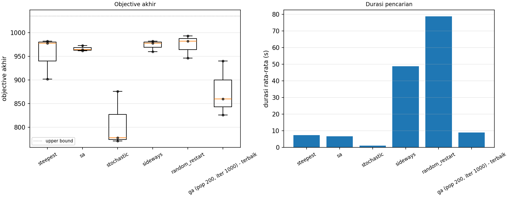
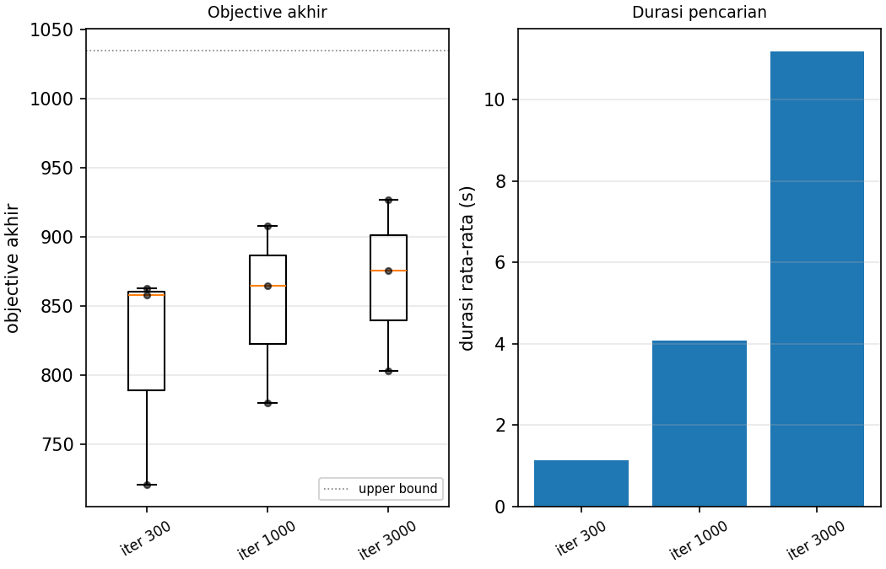
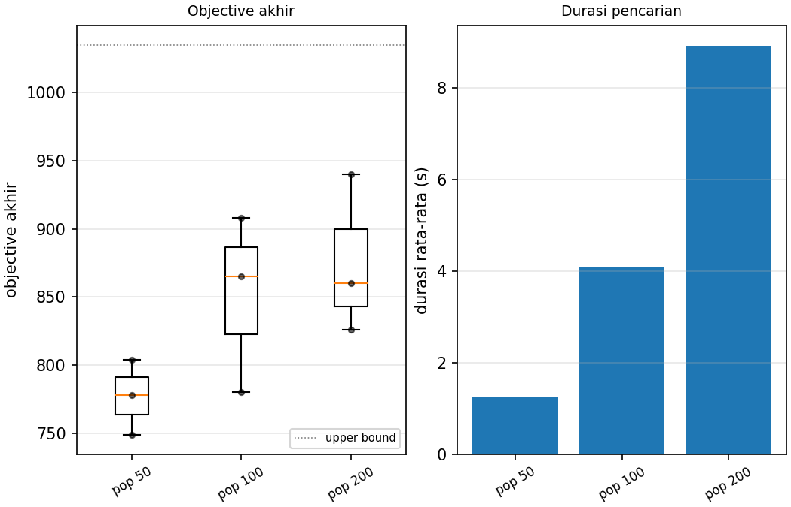

# Ringkasan eksperimen

Dibuat oleh `src/experiments.py` pada 2026-10-21 15:22.
Mesin: Windows-11-10.0.26200-SP0 | CPU Intel64 Family 6 Model 186 Stepping 3, GenuineIntel (12 thread) | Python 3.14.3.
Run tersedia: 33. Durasi = search saja (`duration_s`), tidak termasuk menyimpan file dan gambar.
Belum ada / dilewati (3): `steepest/main_eta_seed1`, `steepest/main_eta_seed2`, `steepest/main_eta_seed3`

### 4.1 Hill-Climbing - Steepest Ascent

| Run | Seed | Obj awal | Obj akhir | Fee | Feasible | Gap UB | Iterasi | Evals | Durasi (s) |
|---|---|---|---|---|---|---|---|---|---|
| 1 | 1 | -21226 | 982 | 982 | True | 5.1% | 16 | 208452 | 5.628 |
| 2 | 2 | -50553 | 978 | 978 | True | 5.5% | 20 | 258031 | 9.368 |
| 3 | 3 | -28402 | 902 | 902 | True | 12.9% | 17 | 221238 | 6.997 |
| **mean ± std** |  |  | 954.0 ± 45.1 | 954.0 ± 45.1 |  |  |  |  | 7.331 ± 1.892 |

### 4.2 Hill-Climbing - Stochastic (Bonus 2)

| Run | Seed | Obj awal | Obj akhir | Fee | Feasible | Gap UB | Iterasi | Evals | Durasi (s) |
|---|---|---|---|---|---|---|---|---|---|
| 1 | 1 | -21226 | 778 | 778 | True | 24.8% | 36486 | 36486 | 0.850 |
| 2 | 2 | -50553 | 876 | 876 | True | 15.4% | 32510 | 32510 | 0.854 |
| 3 | 3 | -28402 | 771 | 771 | True | 25.5% | 24504 | 24504 | 1.214 |
| **mean ± std** |  |  | 808.3 ± 58.7 | 808.3 ± 58.7 |  |  |  |  | 0.973 ± 0.209 |

### 4.3 Hill-Climbing - Sideways Move

| Run | Seed | Obj awal | Obj akhir | Fee | Feasible | Gap UB | Iterasi | #Sideways | Durasi (s) |
|---|---|---|---|---|---|---|---|---|---|
| 1 | 1 | -21226 | 982 | 982 | True | 5.1% | 116 | 100 | 48.765 |
| 2 | 2 | -50553 | 978 | 978 | True | 5.5% | 120 | 100 | 49.008 |
| 3 | 3 | -28402 | 960 | 960 | True | 7.2% | 118 | 100 | 48.126 |
| **mean ± std** |  |  | 973.3 ± 11.7 | 973.3 ± 11.7 |  |  |  |  | 48.633 ± 0.455 |

### 4.4 Hill-Climbing - Random Restart

| Run | Seed | Obj akhir | Fee | Feasible | Gap UB | #Restart | Iterasi per restart | Durasi (s) |
|---|---|---|---|---|---|---|---|---|
| 1 | 1 | 982 | 982 | True | 5.1% | 10 | 16, 14, 20, 17, 16, 15, 17, 17, 23, 16, 22 | 79.324 |
| 2 | 2 | 993 | 993 | True | 4.1% | 10 | 20, 18, 17, 13, 22, 14, 15, 22, 18, 18, 18 | 78.999 |
| 3 | 3 | 946 | 946 | True | 8.6% | 10 | 17, 23, 17, 16, 20, 16, 20, 19, 17, 18, 14 | 77.767 |
| **mean ± std** |  | 973.7 ± 24.6 | 973.7 ± 24.6 |  |  |  |  | 78.697 ± 0.821 |

### 4.5 Simulated Annealing

| Run | Seed | Obj awal | Obj akhir | Fee | Feasible | Gap UB | Iterasi | #Stuck | Durasi (s) |
|---|---|---|---|---|---|---|---|---|---|
| 1 | 1 | -21226 | 964 | 964 | True | 6.9% | 100000 | 182 | 7.037 |
| 2 | 2 | -50553 | 973 | 973 | True | 6.0% | 100000 | 185 | 6.651 |
| 3 | 3 | -28402 | 962 | 962 | True | 7.1% | 100000 | 179 | 6.186 |
| **mean ± std** |  |  | 966.3 ± 5.9 | 966.3 ± 5.9 |  |  |  |  | 6.625 ± 0.426 |

### 4.6 GA - kontrol populasi, variasi iterasi

| Iterasi | Run | Seed | Obj akhir (best) | Fee | Feasible | Gap UB | Durasi (s) |
|---|---|---|---|---|---|---|---|
| 300 | 1-3 | 1,2,3 | 721 / 863 / 858 (mean 814.0 ± 80.6) | 721 / 863 / 858 | True / True / True | 30.3% / 16.6% / 17.1% | 1.107 / 1.120 / 1.168 |
| 1000 | 1-3 | 1,2,3 | 780 / 908 / 865 (mean 851.0 ± 65.1) | 780 / 908 / 865 | True / True / True | 24.6% / 12.3% / 16.4% | 3.489 / 4.906 / 3.859 |
| 3000 | 1-3 | 1,2,3 | 803 / 927 / 876 (mean 868.7 ± 62.3) | 803 / 927 / 876 | True / True / True | 22.4% / 10.4% / 15.4% | 10.849 / 10.968 / 11.740 |

### 4.7 GA - kontrol iterasi, variasi populasi

| Populasi | Run | Seed | Obj akhir (best) | Fee | Feasible | Gap UB | Durasi (s) |
|---|---|---|---|---|---|---|---|
| 50 | 1-3 | 1,2,3 | 749 / 778 / 804 (mean 777.0 ± 27.5) | 749 / 778 / 804 | True / True / True | 27.6% / 24.8% / 22.3% | 1.233 / 1.219 / 1.311 |
| 100 | 1-3 | 1,2,3 | 780 / 908 / 865 (mean 851.0 ± 65.1) | 780 / 908 / 865 | True / True / True | 24.6% / 12.3% / 16.4% | 3.489 / 4.906 / 3.859 |
| 200 | 1-3 | 1,2,3 | 860 / 940 / 826 (mean 875.3 ± 58.5) | 860 / 940 / 826 | True / True / True | 16.9% / 9.2% / 20.2% | 9.969 / 8.509 / 8.269 |

### 4.8 Bonus 3 - multi-kapal

| Run | Seed | Obj awal | Obj akhir | Fee | Feasible | Gap UB | Berat per kapal | Kendaraan per kapal | Durasi (s) |
|---|---|---|---|---|---|---|---|---|---|
| 1 | 1 | -59430 | 1170 | 1170 | True | 11.2% | 70/80 / 51/54 / 30/32 | 10 / 6 / 5 | 18.668 |
| 2 | 2 | -37965 | 1072 | 1072 | True | 18.7% | 63/80 / 54/54 / 26/32 | 13 / 5 / 5 | 15.176 |
| 3 | 3 | -76448 | 1078 | 1078 | True | 18.2% | 78/80 / 48/54 / 15/32 | 4 / 8 / 7 | 19.427 |
| **mean ± std** |  |  | 1106.7 ± 54.9 | 1106.7 ± 54.9 |  |  |  |  | 17.757 ± 2.267 |

### 4.9 Ringkasan antar-algoritma (instance utama)

| Algoritma | Best | Mean ± std | Gap UB (mean) | Durasi mean (s) | Evals mean |
|---|---|---|---|---|---|
| steepest | 982 | 954.0 ± 45.1 | 7.8% | 7.331 | 229240 |
| sa | 973 | 966.3 ± 5.9 | 6.6% | 6.625 | 100100 |
| stochastic | 876 | 808.3 ± 58.7 | 21.9% | 0.973 | 31167 |
| sideways | 982 | 973.3 ± 11.7 | 6.0% | 48.633 | 1454799 |
| random_restart | 993 | 973.7 ± 24.6 | 5.9% | 78.697 | 2534374 |
| ga (pop 200, iter 1000) - terbaik | 940 | 875.3 ± 58.5 | 15.4% | 8.916 | 198200 |

### Gambar ringkasan

